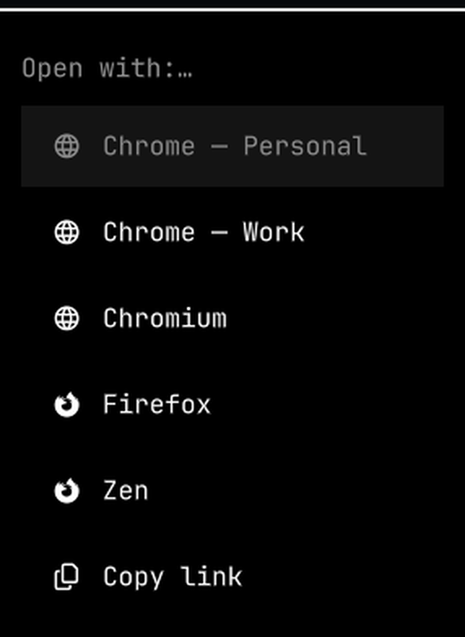

# Open With — Omarchy plugin



Click a link anywhere — a chat app, the terminal, a PDF, a notification — and a
small native menu asks **which browser and which profile** it opens in. Or copy
it.

That's the whole plugin. No per-site learning, no bar widget, no config file.
Only the browsers and profiles you actually have installed show up in the list.

## Why

If you run more than one browser profile — one per client, per project, per
identity — nothing outside the browser knows they exist. Every app that opens a
link just asks the system for "a browser" and the URL lands wherever. Open With
puts the choice in front of you at the moment the link opens, and adds a
**Copy link** row for when you didn't want to open it at all.

If you want links to route themselves by domain, or a remembered default, use
[Browser Picker](https://github.com/K53N0/omarchy-browser-picker) instead — this
one is deliberately the minimal version.

## Requirements

- Omarchy 4 (`omarchy-shell`)
- `wl-clipboard` — for the Copy link row
- `jq` — to list profiles (without it you still get one row per browser)
- a menu program: the native Omarchy menu, or `fuzzel` / `wofi` / `rofi`

## Install

```bash
omarchy plugin add https://github.com/jlescanog/omarchy-open-with.git --enable --yes
```

Then make it your default link handler (reversible — it saves the current one):

```bash
~/.config/omarchy/plugins/io.github.jlescanog.open-with/bin/open-with-ctl install
```

or from the shell IPC:

```bash
omarchy-shell io.github.jlescanog.open-with install
```

## Uninstall

```bash
~/.config/omarchy/plugins/io.github.jlescanog.open-with/bin/open-with-ctl uninstall
omarchy plugin remove io.github.jlescanog.open-with
```

`uninstall` restores whatever browser was the default before.

## Keybinding (optional)

Bind the menu to a key for the current clipboard URL, e.g. in
`~/.config/hypr/bindings.conf`:

```
bindd = SUPER, B, Open link with…, exec, omarchy-shell io.github.jlescanog.open-with clipboard
```

## Supported browsers

Chrome, Chromium, Brave, Edge, Vivaldi, Opera, Thorium (with per-profile rows),
and Firefox, LibreWolf, Floorp, Waterfox, Zen. Anything not installed is simply
absent from the menu.

## How it works

`open-with-ctl install` writes
`~/.local/share/applications/io.github.jlescanog.open-with.desktop` pointing at
`bin/omarchy-open-with %u` and sets it as the `xdg-mime` default. When a link is
opened, that script lists the installed browsers/profiles, shows the menu, and
launches the choice detached via `systemd-run --user` — passing the browser and
profile as a real argument vector, never as a shell string.

`Service.qml` is a thin singleton: it never intercepts links itself, runs no
long-lived process, and only exposes `open` / `clipboard` / `install` /
`uninstall` / `status` over IPC.

## License

MIT — see [LICENSE](LICENSE).
